<!-- Editorial redesign: October 2026. Generated Snapshot dates in image alt text are refreshed with the assets. -->

<picture>
  <source media="(prefers-color-scheme: dark) and (max-width: 600px)" srcset="assets/profile/workspace-mobile-dark.svg">
  <source media="(max-width: 600px)" srcset="assets/profile/workspace-mobile-light.svg">
  <source media="(prefers-color-scheme: dark)" srcset="assets/profile/workspace-dark.svg">
  
</picture>

  <a href="https://ajt-portfolio.vercel.app/"><strong>Portfolio ↗</strong></a> ·
  <a href="https://www.spigotmc.org/resources/authors/tonim.2341103/">SpigotMC</a> ·
  <a href="https://modrinth.com/user/ZpkDxGames">Modrinth</a> ·
  <a href="mailto:antoniojtneto.corp@gmail.com">Email</a>

  <a href="#selected-work">Selected work</a> /
  <a href="#web--interfaces">Web &amp; interfaces</a> /
  <a href="#the-plexon-ecosystem">Ecosystem</a> /
  <a href="#project-observatory">Observatory</a> /
  <a href="#developer-toolkit">Toolkit</a>

I'm **Tonim**, also known as **ZpkDxGames**, a developer and Computer Science student. I build Minecraft server systems, web interfaces and useful tools. I care about the connection between a feature's logic and the experience of using it: clear feedback, reliable state and interfaces people can understand.

**Plexon** brings much of that work together, from independently versioned gameplay modules to shared infrastructure and a browser command center. Alongside it, I work on desktop interfaces, 3D avatars and smaller web projects.

## At a glance

<picture>
  <source media="(prefers-color-scheme: dark) and (max-width: 600px)" srcset="assets/profile/kpis-mobile-dark.svg">
  <source media="(max-width: 600px)" srcset="assets/profile/kpis-mobile-light.svg">
  <source media="(prefers-color-scheme: dark)" srcset="assets/profile/kpis-dark.svg">
  
</picture>

## Selected work

From server operations to the player experience.

<table>
<tr>
<td width="50%" valign="top">
<a href="https://github.com/ZpkDxGames/PlexonPanel">
<picture>
  <source media="(prefers-color-scheme: dark) and (max-width: 600px)" srcset="assets/profile/spotlight-panel-mobile-dark.svg">
  <source media="(max-width: 600px)" srcset="assets/profile/spotlight-panel-mobile-light.svg">
  <source media="(prefers-color-scheme: dark)" srcset="assets/profile/spotlight-panel-dark.svg">
  
</picture>
</a>
<h3><a href="https://github.com/ZpkDxGames/PlexonPanel">PlexonPanel</a></h3>

<strong>A clearer view of your servers.</strong>

Paper servers, Linux hosts and a browser dashboard connected by a shared fleet protocol.

<code>Java</code> <code>Paper</code> <code>Protocol 3</code>

<a href="https://github.com/ZpkDxGames/PlexonPanel">Server &amp; host ↗</a> · <a href="https://github.com/ZpkDxGames/PlexonPanel-Dashboard">Dashboard ↗</a>

</td>
<td width="50%" valign="top">
<a href="https://github.com/ZpkDxGames/PlexonTools">
<picture>
  <source media="(prefers-color-scheme: dark) and (max-width: 600px)" srcset="assets/profile/spotlight-tools-mobile-dark.svg">
  <source media="(max-width: 600px)" srcset="assets/profile/spotlight-tools-mobile-light.svg">
  <source media="(prefers-color-scheme: dark)" srcset="assets/profile/spotlight-tools-dark.svg">
  
</picture>
</a>
<h3><a href="https://github.com/ZpkDxGames/PlexonTools">PlexonTools</a></h3>

<strong>Tools that grow with the player.</strong>

World-activated custom tools with unique identities, persistent progression and SQLite-backed provenance.

<code>Java</code> <code>Paper</code> <code>SQLite</code>

<a href="https://github.com/ZpkDxGames/PlexonTools">Source ↗</a> · <a href="https://github.com/ZpkDxGames/PlexonTools/releases">Releases ↗</a>

</td>
</tr>
<tr>
<td width="50%" valign="top">
<a href="https://github.com/ZpkDxGames/PlexonQuests">
<picture>
  <source media="(prefers-color-scheme: dark) and (max-width: 600px)" srcset="assets/profile/spotlight-quests-mobile-dark.svg">
  <source media="(max-width: 600px)" srcset="assets/profile/spotlight-quests-mobile-light.svg">
  <source media="(prefers-color-scheme: dark)" srcset="assets/profile/spotlight-quests-dark.svg">
  
</picture>
</a>
<h3><a href="https://github.com/ZpkDxGames/PlexonQuests">PlexonQuests</a></h3>

<strong>Choose your next objective.</strong>

Explicitly joined daily, weekly and milestone quests with persisted history and guarded reward claims.

<code>Java</code> <code>Quest board</code> <code>SQLite</code>

<a href="https://github.com/ZpkDxGames/PlexonQuests">Source ↗</a> · <a href="https://github.com/ZpkDxGames/PlexonQuests/releases">Releases ↗</a>

</td>
<td width="50%" valign="top">
<a href="https://github.com/ZpkDxGames/PlexonChats">
<picture>
  <source media="(prefers-color-scheme: dark) and (max-width: 600px)" srcset="assets/profile/spotlight-chats-mobile-dark.svg">
  <source media="(max-width: 600px)" srcset="assets/profile/spotlight-chats-mobile-light.svg">
  <source media="(prefers-color-scheme: dark)" srcset="assets/profile/spotlight-chats-dark.svg">
  
</picture>
</a>
<h3><a href="https://github.com/ZpkDxGames/PlexonChats">PlexonChats</a></h3>

<strong>Make communication part of play.</strong>

Local and global chat, private messaging and persistent Chat Events, with optional Discord bridging.

<code>Java</code> <code>MiniMessage</code> <code>Chat Events</code>

<a href="https://github.com/ZpkDxGames/PlexonChats">Source ↗</a> · <a href="https://github.com/ZpkDxGames/PlexonChats/releases">Releases ↗</a>

</td>
</tr>
<tr>
<td width="50%" valign="top">
<a href="https://github.com/ZpkDxGames/AI-Desktop-Companion">
<picture>
  <source media="(prefers-color-scheme: dark) and (max-width: 600px)" srcset="assets/profile/spotlight-companion-mobile-dark.svg">
  <source media="(max-width: 600px)" srcset="assets/profile/spotlight-companion-mobile-light.svg">
  <source media="(prefers-color-scheme: dark)" srcset="assets/profile/spotlight-companion-dark.svg">
  
</picture>
</a>
<h3><a href="https://github.com/ZpkDxGames/AI-Desktop-Companion">AI Desktop Companion</a></h3>

<strong>An avatar for your desktop.</strong>

An alpha Windows companion with a skin-based 3D Minecraft avatar and local controls. AI actions remain disabled.

<code>JavaScript</code> <code>Three.js</code> <code>Tauri</code>

<a href="https://github.com/ZpkDxGames/AI-Desktop-Companion">Source ↗</a> · <a href="https://github.com/ZpkDxGames/AI-Desktop-Companion/releases">Releases ↗</a>

</td>
<td width="50%" valign="top">
<a href="https://github.com/ZpkDxGames/PlexonCore">
<picture>
  <source media="(prefers-color-scheme: dark) and (max-width: 600px)" srcset="assets/profile/spotlight-core-mobile-dark.svg">
  <source media="(max-width: 600px)" srcset="assets/profile/spotlight-core-mobile-light.svg">
  <source media="(prefers-color-scheme: dark)" srcset="assets/profile/spotlight-core-dark.svg">
  
</picture>
</a>
<h3><a href="https://github.com/ZpkDxGames/PlexonCore">PlexonCore</a></h3>

<strong>One foundation. Focused modules.</strong>

Shared event routing, configuration, UI helpers, storage and diagnostics for independently versioned modules.

<code>Java</code> <code>Core API</code> <code>SQLite</code>

<a href="https://github.com/ZpkDxGames/PlexonCore">Source ↗</a> · <a href="https://github.com/ZpkDxGames/PlexonCore/releases">Releases ↗</a>

</td>
</tr>
</table>

Illustrations are conceptual, not product screenshots or live telemetry. Vitals are generated from public data. “Stable” means the latest non-prerelease publication in the snapshot window; it does not certify production readiness. PlexonPanel's rollout remains gated; AI Desktop Companion is an alpha.

## Web & interfaces

Interfaces are part of the work, from operations dashboards to local exploration.

| Project | Interface & links |
| :--- | :--- |
| **[Panel dashboard](https://github.com/ZpkDxGames/PlexonPanel-Dashboard)** | React, TypeScript and Vite command center for the PlexonPanel fleet protocol. Deployment follows its documented acceptance gates. |
| **[Neural Core Dashboard](https://github.com/ZpkDxGames/Neural-Core-Dashboard)** | Foundation alpha: a local-first conversation archive explorer with a Next.js interface and a 3D network view. |
| **[Conan Gray Bot dashboard](https://github.com/ZpkDxGames/ConanGrayBot-Page)** | Browser controls and settings for the bot. Explore its interface source in the repository. |
| **[Triangle Area](https://github.com/ZpkDxGames/Triangle-Area)** | A web exercise for calculating a triangle's area. [Try the demo ↗](https://tonim-triangle-area-activity.vercel.app/) |

More web work: [professional portfolio ↗](https://ajt-portfolio.vercel.app/) · [creator hub ↗](https://tonim-lp.vercel.app/). The desktop companion is featured above.

## The Plexon ecosystem

Focused repositories with distinct responsibilities. **[PlexonCore](https://github.com/ZpkDxGames/PlexonCore)** supplies shared runtime services; each module's README defines its actual integration and requirements.

<picture>
  <source media="(prefers-color-scheme: dark) and (max-width: 600px)" srcset="assets/profile/architecture-mobile-dark.svg">
  <source media="(max-width: 600px)" srcset="assets/profile/architecture-mobile-light.svg">
  <source media="(prefers-color-scheme: dark)" srcset="assets/profile/architecture-dark.svg">
  
</picture>

| Module | Responsibility |
| :--- | :--- |
| **[Core](https://github.com/ZpkDxGames/PlexonCore)** | Shared runtime, event routing, configuration, UI, storage and diagnostics. |
| **[Panel](https://github.com/ZpkDxGames/PlexonPanel)** | Paper and host operations, pairing and fleet coordination. |
| **[Panel Dashboard](https://github.com/ZpkDxGames/PlexonPanel-Dashboard)** | Browser command center. |
| **[Utility](https://github.com/ZpkDxGames/PlexonUtility)** | Player utilities, HUD feedback and staff controls. |
| **[Tools](https://github.com/ZpkDxGames/PlexonTools)** | Unique, world-activated custom-tool progression. |
| **[Quests](https://github.com/ZpkDxGames/PlexonQuests)** | Joined daily, weekly and milestone objectives. |
| **[Ranks](https://github.com/ZpkDxGames/PlexonRanks)** | Rank progression and requirements. |
| **[Skills](https://github.com/ZpkDxGames/PlexonSkills)** | RPG skills, abilities and progression. |
| **[Keys](https://github.com/ZpkDxGames/PlexonKeys)** | Key identity, virtual balances, physical claims and acquisition provenance. |
| **[DailyRewards](https://github.com/ZpkDxGames/Plexon-DailyRewards)** | Configurable calendar-based reward tracks. |
| **[Crates](https://github.com/ZpkDxGames/PlexonCrates)** | Retired crate implementation, retained as historical source. |
| **[Chats](https://github.com/ZpkDxGames/PlexonChats)** | Communication, Chat Events and Bingo. |
| **[Shops](https://github.com/ZpkDxGames/PlexonShops)** | Player-shop discovery and directory; server item trading remains external. |
| **[Jobs](https://github.com/ZpkDxGames/PlexonJobs)** | Occupations, progression, payouts and player feedback. |
| **[Homes](https://github.com/ZpkDxGames/PlexonHomes)** | Named homes, safe travel and migration tooling. |
| **[Travel](https://github.com/ZpkDxGames/PlexonTravel)** | Spawn, hub, warps, back, TPA and scoped random travel. |
| **[Backpacks](https://github.com/ZpkDxGames/PlexonBackpacks)** | Tiered backpacks with persistent item-specific storage. |
| **[Spawners](https://github.com/ZpkDxGames/PlexonSpawners)** | Recovery and reward policy around WildStacker's authoritative spawners. |
| **[Blacksmith](https://github.com/ZpkDxGames/PlexonBlacksmith)** | Exact-item repair, combine and enchant workstation. |
| **[GPFlags](https://github.com/ZpkDxGames/PlexonGPFlags)** | Claim policy and editing around GriefPrevention. |
| **[GriefPrevention addon](https://github.com/ZpkDxGames/PlexonGriefPreventionAddon)** | Deprecated predecessor; use GPFlags for the replacement. |

**Beyond Plexon:** [GhostBlocks](https://github.com/ZpkDxGames/GhostBlocks) adds collision-free decoration using state-preserving BlockDisplay models and a searchable catalog.

<strong>Earlier projects &amp; upstream credits</strong>

- [Rankup 1.2 Fixer](https://github.com/ZpkDxGames/Rankup-1.2Fixer) — a compatibility fork of comonier's Rankup, with configurable rank-menu lore for PlexonCraft.
- [FluffyMachines](https://github.com/ZpkDxGames/FluffyMachines) — a public fork of the Slimefun machines and tools addon.
- [DropsEditor](https://github.com/ZpkDxGames/DropsEditor) — earlier custom-drop plugin code; its plugin metadata credits cubito_verde.

## Project observatory

A rolling **90-day view of public projects**. Commits include all authors except bots and are deduplicated across each repository's current branch histories. They are **project-wide commits, not my personal contributions**.

<picture>
  <source media="(prefers-color-scheme: dark) and (max-width: 600px)" srcset="assets/profile/activity-mobile-dark.svg">
  <source media="(max-width: 600px)" srcset="assets/profile/activity-mobile-light.svg">
  <source media="(prefers-color-scheme: dark)" srcset="assets/profile/activity-dark.svg">
  
</picture>

<picture>
  <source media="(prefers-color-scheme: dark) and (max-width: 600px)" srcset="assets/profile/projects-mobile-dark.svg">
  <source media="(max-width: 600px)" srcset="assets/profile/projects-mobile-light.svg">
  <source media="(prefers-color-scheme: dark)" srcset="assets/profile/projects-dark.svg">
  
</picture>

<picture>
  <source media="(prefers-color-scheme: dark) and (max-width: 600px)" srcset="assets/profile/languages-mobile-dark.svg">
  <source media="(max-width: 600px)" srcset="assets/profile/languages-mobile-light.svg">
  <source media="(prefers-color-scheme: dark)" srcset="assets/profile/languages-dark.svg">
  
</picture>

The split classifies repositories by purpose, not individual files. A web project may also contain backend or native code. Each group retains its exact byte total.

<picture>
  <source media="(prefers-color-scheme: dark) and (max-width: 600px)" srcset="assets/profile/cadence-mobile-dark.svg">
  <source media="(max-width: 600px)" srcset="assets/profile/cadence-mobile-light.svg">
  <source media="(prefers-color-scheme: dark)" srcset="assets/profile/cadence-dark.svg">
  
</picture>

<picture>
  <source media="(prefers-color-scheme: dark) and (max-width: 600px)" srcset="assets/profile/versions-mobile-dark.svg">
  <source media="(max-width: 600px)" srcset="assets/profile/versions-mobile-light.svg">
  <source media="(prefers-color-scheme: dark)" srcset="assets/profile/versions-dark.svg">
  
</picture>

<strong>Build rhythm · 90-day calendar</strong>

 

<picture>
  <source media="(prefers-color-scheme: dark) and (max-width: 600px)" srcset="assets/profile/heatmap-mobile-dark.svg">
  <source media="(max-width: 600px)" srcset="assets/profile/heatmap-mobile-light.svg">
  <source media="(prefers-color-scheme: dark)" srcset="assets/profile/heatmap-dark.svg">
  
</picture>

<strong>Release radar · recent publications</strong>

 

<picture>
  <source media="(prefers-color-scheme: dark) and (max-width: 600px)" srcset="assets/profile/releases-mobile-dark.svg">
  <source media="(max-width: 600px)" srcset="assets/profile/releases-mobile-light.svg">
  <source media="(prefers-color-scheme: dark)" srcset="assets/profile/releases-dark.svg">
  
</picture>

Scheduled daily · public, owned, non-fork, non-archived, enabled repositories · profile excluded. Last snapshot day may be incomplete.

[Snapshot data](data/profile.json) · [Measurement & design](docs/profile-visuals.md) · [Refresh history](https://github.com/ZpkDxGames/zpkdxgames/actions/workflows/profile-metrics.yml)

## Developer toolkit

Java for server work; web technologies for interfaces; automation for repeatable delivery.

<strong>Languages</strong>

<picture>
  <source media="(prefers-color-scheme: dark)" srcset="assets/profile/toolkit-java-dark.svg">
  
</picture>
<picture>
  <source media="(prefers-color-scheme: dark)" srcset="assets/profile/toolkit-javascript-dark.svg">
  
</picture>
<picture>
  <source media="(prefers-color-scheme: dark)" srcset="assets/profile/toolkit-html-dark.svg">
  
</picture>
<picture>
  <source media="(prefers-color-scheme: dark)" srcset="assets/profile/toolkit-css-dark.svg">
  
</picture>
<picture>
  <source media="(prefers-color-scheme: dark)" srcset="assets/profile/toolkit-python-dark.svg">
  
</picture>

<strong>Build &amp; delivery</strong>

<picture>
  <source media="(prefers-color-scheme: dark)" srcset="assets/profile/toolkit-git-dark.svg">
  
</picture>
<picture>
  <source media="(prefers-color-scheme: dark)" srcset="assets/profile/toolkit-github-dark.svg">
  
</picture>
<picture>
  <source media="(prefers-color-scheme: dark)" srcset="assets/profile/toolkit-actions-dark.svg">
  
</picture>
<picture>
  <source media="(prefers-color-scheme: dark)" srcset="assets/profile/toolkit-gradle-dark.svg">
  
</picture>
<picture>
  <source media="(prefers-color-scheme: dark)" srcset="assets/profile/toolkit-maven-dark.svg">
  
</picture>
<picture>
  <source media="(prefers-color-scheme: dark)" srcset="assets/profile/toolkit-vercel-dark.svg">
  
</picture>

<strong>Server &amp; web kits</strong>

<picture>
  <source media="(prefers-color-scheme: dark)" srcset="assets/profile/toolkit-paper-dark.svg">
  
</picture>
<picture>
  <source media="(prefers-color-scheme: dark)" srcset="assets/profile/toolkit-minimessage-dark.svg">
  
</picture>
<picture>
  <source media="(prefers-color-scheme: dark)" srcset="assets/profile/toolkit-nextjs-dark.svg">
  
</picture>
<picture>
  <source media="(prefers-color-scheme: dark)" srcset="assets/profile/toolkit-sqlite-dark.svg">
  
</picture>

Dashboard frontend: React · TypeScript · Vite Server integrations: Vault · LuckPerms · PlaceholderAPI

<strong>Approach &amp; background</strong>

My experience in finance, administration, logistics and customer support shapes how I build software: clear workflows, useful feedback and documentation people can follow.

Portuguese native · English B2 · Open to remote collaboration and opportunities.

## Let's build something

Minecraft tooling, a web interface or an idea worth exploring — **let's talk**.

  <a href="mailto:antoniojtneto.corp@gmail.com"><strong>Email ↗</strong></a> ·
  <a href="https://www.linkedin.com/in/antoniojtneto">LinkedIn ↗</a> ·
  <a href="https://discord.gg/DC3pFQSJy7">Discord ↗</a> ·
  <a href="https://ajt-portfolio.vercel.app/">Portfolio ↗</a> ·
  <a href="https://tonim-lp.vercel.app/">Creator hub ↗</a>

TONIM / ZPKDXGAMES — Thoughtful systems. Expressive worlds.

