<!-- ZpkDxGames profile · responsive edition · generated visuals live in assets/ -->

 

## Engineering that survives contact with production

I build Minecraft server systems, backend services, and operational tooling with a simple goal: make complex behavior feel clear to players and predictable to operators.

My work sits where gameplay, distributed state, and real-world operations meet—event-driven mechanics, persistent data, secure control planes, telemetry, deployment, and recovery.

## Live engineering pulse

This snapshot is rebuilt automatically from public GitHub data. It is intentionally compact: the important numbers remain legible on a phone without zooming.

## Selected work

### [PlexonPanel](https://github.com/ZpkDxGames/PlexonPanel)

A coordinated operations system for multiple Paper servers, with signed protocol contracts, per-instance identity, telemetry, pairing, backups, and recovery controls.

`Java` · `Paper` · `Linux operations` · `Fleet coordination`

### [AI Desktop Companion](https://github.com/ZpkDxGames/AI-Desktop-Companion)

A local-first Windows desktop companion that renders a Minecraft skin as an expressive 3D character, with a carefully controlled animation and desktop-overlay foundation.

`JavaScript` · `Three.js` · `Tauri` · `Local-first`

### [Neural Core Dashboard](https://github.com/ZpkDxGames/Neural-Core-Dashboard)

A local-first personal knowledge network for conversation archives, with an interactive 3D graph, browser-local persistence, and an optional private backend path.

`TypeScript` · `Next.js` · `WebGL` · `IndexedDB`

### [PlexonPanel Command Center](https://github.com/ZpkDxGames/PlexonPanel-Dashboard)

A responsive operations dashboard for the PlexonPanel control plane, designed around live server state, pairing, observability, and safe operator workflows.

`TypeScript` · `React` · `Vite` · `Realtime UI`

## Working principles

- **Native before novel.** Features should feel as though they belong in the platform.
- **Explicit state.** Ownership, transitions, failure modes, and recovery paths should be visible.
- **Observe the real system.** Telemetry and diagnostics are part of the product—not an afterthought.
- **Ship with a way back.** Changes need validation, bounded rollout, and a credible rollback path.

## Toolchain

`Java` · `Paper API` · `Spigot API` · `TypeScript` · `React` · `Node.js` · `Python` · `SQL` · `REST` · `WebSocket` · `Gradle` · `Maven` · `GitHub Actions` · `Linux`

## Connect

The best place to explore the work is the repository list. For project-specific problems, open an issue with the version, reproduction steps, logs, and the expected behavior.

[GitHub](https://github.com/ZpkDxGames) · [Portfolio](https://ajt-portfolio.vercel.app/) · [LinkedIn](https://www.linkedin.com/in/antoniojtneto) · [Modrinth](https://modrinth.com/user/ZpkDxGames) · [SpigotMC](https://www.spigotmc.org/members/tonim.2373504/)

 

