<!-- Profile design: October 2026. Charts use the dated public snapshot in data/profile.json. -->

<picture>
  <source media="(prefers-color-scheme: dark) and (max-width: 600px)" srcset="assets/profile/workspace-mobile-dark.svg">
  <source media="(max-width: 600px)" srcset="assets/profile/workspace-mobile-light.svg">
  <source media="(prefers-color-scheme: dark)" srcset="assets/profile/workspace-dark.svg">
  
</picture>

  <a href="https://ajt-portfolio.vercel.app/"><strong>Portfolio ↗</strong></a> &nbsp; · &nbsp;
  <a href="https://www.spigotmc.org/resources/authors/tonim.2341103/">SpigotMC</a> &nbsp; · &nbsp;
  <a href="https://modrinth.com/user/ZpkDxGames">Modrinth</a> &nbsp; · &nbsp;
  <a href="mailto:antoniojtneto.corp@gmail.com">Get in touch</a>

  <a href="#selected-work">Selected work</a> &nbsp; / &nbsp;
  <a href="#the-plexon-ecosystem">Ecosystem</a> &nbsp; / &nbsp;
  <a href="#project-observatory">Observatory</a> &nbsp; / &nbsp;
  <a href="#developer-toolkit">Toolkit</a>

I'm **Tonim**, also known as **ZpkDxGames** — a developer and Computer Science student building **Minecraft server systems and web experiences**. My work connects the logic behind a feature with the experience of using it: clear interfaces, meaningful progression, and tools that make complex systems easier to operate.

**Plexon** is where those ideas come together. I work across gameplay plugins, shared infrastructure, dashboards, and automation, with attention to persistence, performance, and the small details players notice.

## Selected work

From the server room to the player experience.

<table>
<tr>
<td width="50%" valign="top">
<a href="https://github.com/ZpkDxGames/PlexonPanel">
<picture>
  <source media="(prefers-color-scheme: dark)" srcset="assets/profile/spotlight-panel-dark.svg">
  
</picture>
</a>
<h3><a href="https://github.com/ZpkDxGames/PlexonPanel">PlexonPanel</a></h3>

<strong>A clearer view of your servers.</strong>

Paper and host telemetry, pairing, console workflows, and a dedicated browser command center.

<code>Java</code> <code>Paper</code> <code>React / TypeScript</code>

<a href="https://github.com/ZpkDxGames/PlexonPanel">Server &amp; host ↗</a> &nbsp; <a href="https://github.com/ZpkDxGames/PlexonPanel-Dashboard">Dashboard ↗</a>

</td>
<td width="50%" valign="top">
<a href="https://github.com/ZpkDxGames/PlexonTools">
<picture>
  <source media="(prefers-color-scheme: dark)" srcset="assets/profile/spotlight-tools-dark.svg">
  
</picture>
</a>
<h3><a href="https://github.com/ZpkDxGames/PlexonTools">PlexonTools</a></h3>

<strong>Tools that grow with the player.</strong>

Unique tool identities, world activation, persistent progression, and SQLite-backed provenance.

<code>Java</code> <code>Progression</code> <code>SQLite</code>

<a href="https://github.com/ZpkDxGames/PlexonTools">Explore source ↗</a> &nbsp; <a href="https://github.com/ZpkDxGames/PlexonTools/releases">Releases ↗</a>

</td>
</tr>
<tr>
<td width="50%" valign="top">
<a href="https://github.com/ZpkDxGames/PlexonQuests">
<picture>
  <source media="(prefers-color-scheme: dark)" srcset="assets/profile/spotlight-quests-dark.svg">
  
</picture>
</a>
<h3><a href="https://github.com/ZpkDxGames/PlexonQuests">PlexonQuests</a></h3>

<strong>Give every session a direction.</strong>

Daily and weekly quests, milestones, rewards, and a visual journal that keeps the next goal in reach.

<code>Java</code> <code>Quest journal</code> <code>Player UX</code>

<a href="https://github.com/ZpkDxGames/PlexonQuests">Explore source ↗</a> &nbsp; <a href="https://github.com/ZpkDxGames/PlexonQuests/releases">Releases ↗</a>

</td>
<td width="50%" valign="top">
<a href="https://github.com/ZpkDxGames/PlexonCrates">
<picture>
  <source media="(prefers-color-scheme: dark)" srcset="assets/profile/spotlight-crates-dark.svg">
  
</picture>
</a>
<h3><a href="https://github.com/ZpkDxGames/PlexonCrates">PlexonCrates</a></h3>

<strong>Make the reveal part of the reward.</strong>

Animated openings, visual reward editing, physical keys, and configurable reward rules.

<code>Java</code> <code>Animation</code> <code>Reward systems</code>

<a href="https://github.com/ZpkDxGames/PlexonCrates">Explore source ↗</a> &nbsp; <a href="https://github.com/ZpkDxGames/PlexonCrates/releases">Releases ↗</a>

</td>
</tr>
</table>

Project illustrations are conceptual. Each repository documents its requirements and release status; PlexonPanel's coordinated rollout remains subject to its documented acceptance gates.

## The Plexon ecosystem

Focused modules with their own gameplay and data. **[PlexonCore](https://github.com/ZpkDxGames/PlexonCore)** supplies shared configuration, UI helpers, storage, and diagnostics for modules that adopt its API.

<picture>
  <source media="(prefers-color-scheme: dark) and (max-width: 600px)" srcset="assets/profile/architecture-mobile-dark.svg">
  <source media="(max-width: 600px)" srcset="assets/profile/architecture-mobile-light.svg">
  <source media="(prefers-color-scheme: dark)" srcset="assets/profile/architecture-dark.svg">
  
</picture>

| Area | Explore |
| :--- | :--- |
| **Operations & infrastructure** | [Core](https://github.com/ZpkDxGames/PlexonCore) · [Panel](https://github.com/ZpkDxGames/PlexonPanel) · [Dashboard](https://github.com/ZpkDxGames/PlexonPanel-Dashboard) |
| **Progression** | [Tools](https://github.com/ZpkDxGames/PlexonTools) · [Quests](https://github.com/ZpkDxGames/PlexonQuests) · [Ranks](https://github.com/ZpkDxGames/PlexonRanks) |
| **Rewards** | [Keys](https://github.com/ZpkDxGames/PlexonKeys) · [Crates](https://github.com/ZpkDxGames/PlexonCrates) · [DailyRewards](https://github.com/ZpkDxGames/Plexon-DailyRewards) |
| **Community** | [Chats](https://github.com/ZpkDxGames/PlexonChats) · [Shops](https://github.com/ZpkDxGames/PlexonShops) |
| **World & inventory** | [Backpacks](https://github.com/ZpkDxGames/PlexonBackpacks) · [Spawners](https://github.com/ZpkDxGames/PlexonSpawners) · [Claim flags](https://github.com/ZpkDxGames/PlexonGriefPreventionAddon) |

**Beyond Plexon** — [GhostBlocks](https://github.com/ZpkDxGames/GhostBlocks) brings collision-free decoration to Minecraft with state-preserving BlockDisplay models and a searchable catalog. [Triangle Area](https://github.com/ZpkDxGames/Triangle-Area) turns coordinate geometry into a visual web experience: [try the demo ↗](https://tonim-triangle-area-activity.vercel.app/).

<strong>Earlier projects &amp; upstream credits</strong>

- [Rankup 1.2 Fixer](https://github.com/ZpkDxGames/Rankup-1.2Fixer) — a compatibility fork of comonier's Rankup, with configurable rank-menu lore for PlexonCraft.
- [FluffyMachines](https://github.com/ZpkDxGames/FluffyMachines) — a public fork of the Slimefun machines and tools addon.
- [DropsEditor](https://github.com/ZpkDxGames/DropsEditor) — earlier custom-drop plugin code; its plugin metadata credits cubito_verde.

## Project observatory

A measured view of my **public projects**, using a rolling 90-day snapshot. These are project-wide commits from all authors except bots, not my personal contribution count. The collection date appears on the activity card.

<picture>
  <source media="(prefers-color-scheme: dark) and (max-width: 600px)" srcset="assets/profile/activity-mobile-dark.svg">
  <source media="(max-width: 600px)" srcset="assets/profile/activity-mobile-light.svg">
  <source media="(prefers-color-scheme: dark)" srcset="assets/profile/activity-dark.svg">
  
</picture>

<picture>
  <source media="(prefers-color-scheme: dark) and (max-width: 600px)" srcset="assets/profile/ecosystem-mobile-dark.svg">
  <source media="(max-width: 600px)" srcset="assets/profile/ecosystem-mobile-light.svg">
  <source media="(prefers-color-scheme: dark)" srcset="assets/profile/ecosystem-dark.svg">
  
</picture>

<strong>Build rhythm · 90-day activity calendar</strong>

 

<picture>
  <source media="(prefers-color-scheme: dark) and (max-width: 600px)" srcset="assets/profile/heatmap-mobile-dark.svg">
  <source media="(max-width: 600px)" srcset="assets/profile/heatmap-mobile-light.svg">
  <source media="(prefers-color-scheme: dark)" srcset="assets/profile/heatmap-dark.svg">
  
</picture>

<strong>Release radar · recent published milestones</strong>

 

<picture>
  <source media="(prefers-color-scheme: dark)" srcset="assets/profile/releases-dark.svg">
  
</picture>

Scheduled daily · public, owned, non-fork, non-archived projects · profile automation excluded. Language share measures source bytes on default branches.

[Snapshot data](data/profile.json) · [How the visuals work](docs/profile-visuals.md) · [Refresh history](https://github.com/ZpkDxGames/zpkdxgames/actions/workflows/profile-metrics.yml)

## Developer toolkit

The tools behind the systems. Java for server work; web technologies for interfaces; automation for repeatable delivery.

<strong>Languages</strong>

<picture>
  <source media="(prefers-color-scheme: dark)" srcset="assets/profile/toolkit-java-dark.svg">
  
</picture>
<picture>
  <source media="(prefers-color-scheme: dark)" srcset="assets/profile/toolkit-javascript-dark.svg">
  
</picture>
<picture>
  <source media="(prefers-color-scheme: dark)" srcset="assets/profile/toolkit-html-dark.svg">
  
</picture>
<picture>
  <source media="(prefers-color-scheme: dark)" srcset="assets/profile/toolkit-css-dark.svg">
  
</picture>
<picture>
  <source media="(prefers-color-scheme: dark)" srcset="assets/profile/toolkit-python-dark.svg">
  
</picture>

<strong>Developer tools &amp; delivery</strong>

<picture>
  <source media="(prefers-color-scheme: dark)" srcset="assets/profile/toolkit-git-dark.svg">
  
</picture>
<picture>
  <source media="(prefers-color-scheme: dark)" srcset="assets/profile/toolkit-github-dark.svg">
  
</picture>
<picture>
  <source media="(prefers-color-scheme: dark)" srcset="assets/profile/toolkit-actions-dark.svg">
  
</picture>
<picture>
  <source media="(prefers-color-scheme: dark)" srcset="assets/profile/toolkit-gradle-dark.svg">
  
</picture>
<picture>
  <source media="(prefers-color-scheme: dark)" srcset="assets/profile/toolkit-maven-dark.svg">
  
</picture>
<picture>
  <source media="(prefers-color-scheme: dark)" srcset="assets/profile/toolkit-vercel-dark.svg">
  
</picture>

<strong>Server &amp; web kits</strong>

<picture>
  <source media="(prefers-color-scheme: dark)" srcset="assets/profile/toolkit-paper-dark.svg">
  
</picture>
<picture>
  <source media="(prefers-color-scheme: dark)" srcset="assets/profile/toolkit-minimessage-dark.svg">
  
</picture>
<picture>
  <source media="(prefers-color-scheme: dark)" srcset="assets/profile/toolkit-nextjs-dark.svg">
  
</picture>
<picture>
  <source media="(prefers-color-scheme: dark)" srcset="assets/profile/toolkit-sqlite-dark.svg">
  
</picture>

Dashboard frontend: React · TypeScript · Vite Server integrations: Vault · LuckPerms · PlaceholderAPI

<strong>Background &amp; approach</strong>

My experience in finance, administration, logistics, and customer support shapes how I build software: clear workflows, useful feedback, and documentation people can follow.

Portuguese native · English B2 · Open to remote collaboration and opportunities.

More web work: [professional portfolio](https://ajt-portfolio.vercel.app/) · [creator hub](https://tonim-lp.vercel.app/).

## Let's build something

Minecraft tooling, a thoughtful web interface, or an idea worth exploring — **let's talk**.

  <a href="mailto:antoniojtneto.corp@gmail.com"><strong>Email ↗</strong></a> &nbsp; · &nbsp;
  <a href="https://www.linkedin.com/in/antoniojtneto">LinkedIn ↗</a> &nbsp; · &nbsp;
  <a href="https://discord.gg/DC3pFQSJy7">Discord ↗</a> &nbsp; · &nbsp;
  <a href="https://ajt-portfolio.vercel.app/">Portfolio ↗</a>

TONIM / ZPKDXGAMES &nbsp; — &nbsp; Thoughtful systems. Expressive worlds.

