<!-- Generated by scripts/profile_dashboard.py. Editorial prose lives in data/project-editorial.json. -->

<picture>
  <source media="(prefers-color-scheme: dark) and (max-width: 600px)" srcset="assets/profile-dashboard/cover-mobile-dark.svg">
  <source media="(max-width: 600px)" srcset="assets/profile-dashboard/cover-mobile-light.svg">
  <source media="(prefers-color-scheme: dark)" srcset="assets/profile-dashboard/cover-dark.svg">
  
</picture>

  <a href="#featured-systems">Projects</a> ·
  <a href="#system-topology">Systems</a> ·
  <a href="#project-observatory">Activity</a> ·
  <a href="#project-observatory">Releases</a> ·
  <a href="#technology-topology">Stack</a> ·
  <a href="#engineering-approach">About</a> ·
  <a href="#contact">Contact</a>

> **Snapshot context:** generated repository data is dated **2026-10-13** and covers **2026-07-16 → 2026-10-13 UTC**. Activity is project-wide across public repositories in scope; it is not realtime telemetry and not a personal contribution streak.

## Engineering status

<picture>
  <source media="(prefers-color-scheme: dark) and (max-width: 600px)" srcset="assets/profile-dashboard/status-mobile-dark.svg">
  <source media="(max-width: 600px)" srcset="assets/profile-dashboard/status-mobile-light.svg">
  <source media="(prefers-color-scheme: dark)" srcset="assets/profile-dashboard/status-dark.svg">
  
</picture>

## Featured systems

Card totals are project-wide snapshot metrics. The small activity heartbeat always labels its own scope; this frozen compatibility snapshot uses verified `MAIN BRANCH · 90D` histories, while native schema-3 refreshes use `PROJECT-WIDE · 90D`.

### [PlexonPanel](https://github.com/ZpkDxGames/PlexonPanel)

Coordinates Paper, per-instance Linux hosts, relay/worker coordination, and a browser dashboard under a signed fleet protocol.

<picture>
  <source media="(prefers-color-scheme: dark) and (max-width: 600px)" srcset="assets/profile-dashboard/project-plexonpanel-mobile-dark.svg">
  <source media="(max-width: 600px)" srcset="assets/profile-dashboard/project-plexonpanel-mobile-light.svg">
  <source media="(prefers-color-scheme: dark)" srcset="assets/profile-dashboard/project-plexonpanel-dark.svg">
  
</picture>
### [PlexonTools](https://github.com/ZpkDxGames/PlexonTools)

Persistent tool identity and progression with in-memory authority, event contracts, natural-block provenance, and bounded asynchronous SQLite persistence.

<picture>
  <source media="(prefers-color-scheme: dark) and (max-width: 600px)" srcset="assets/profile-dashboard/project-plexontools-mobile-dark.svg">
  <source media="(max-width: 600px)" srcset="assets/profile-dashboard/project-plexontools-mobile-light.svg">
  <source media="(prefers-color-scheme: dark)" srcset="assets/profile-dashboard/project-plexontools-dark.svg">
  
</picture>
### [PlexonQuests](https://github.com/ZpkDxGames/PlexonQuests)

Join-based Daily, Weekly, and Milestone quest board with guarded progress, claim state, history, and asynchronous persistence.

<picture>
  <source media="(prefers-color-scheme: dark) and (max-width: 600px)" srcset="assets/profile-dashboard/project-plexonquests-mobile-dark.svg">
  <source media="(max-width: 600px)" srcset="assets/profile-dashboard/project-plexonquests-mobile-light.svg">
  <source media="(prefers-color-scheme: dark)" srcset="assets/profile-dashboard/project-plexonquests-dark.svg">
  
</picture>
### [PlexonChats](https://github.com/ZpkDxGames/PlexonChats)

Routes local/global chat, private messages, chat events, and Bingo with an optional presentation bridge through DiscordSRV.

<picture>
  <source media="(prefers-color-scheme: dark) and (max-width: 600px)" srcset="assets/profile-dashboard/project-plexonchats-mobile-dark.svg">
  <source media="(max-width: 600px)" srcset="assets/profile-dashboard/project-plexonchats-mobile-light.svg">
  <source media="(prefers-color-scheme: dark)" srcset="assets/profile-dashboard/project-plexonchats-dark.svg">
  
</picture>
### [AI-Desktop-Companion](https://github.com/ZpkDxGames/AI-Desktop-Companion)

Local-first Minecraft-skin desktop companion using a deterministic behavior controller, skinview3d/Three.js rendering, and workspace/overlay surfaces.

<picture>
  <source media="(prefers-color-scheme: dark) and (max-width: 600px)" srcset="assets/profile-dashboard/project-ai-desktop-companion-mobile-dark.svg">
  <source media="(max-width: 600px)" srcset="assets/profile-dashboard/project-ai-desktop-companion-mobile-light.svg">
  <source media="(prefers-color-scheme: dark)" srcset="assets/profile-dashboard/project-ai-desktop-companion-dark.svg">
  
</picture>
### [PlexonCore](https://github.com/ZpkDxGames/PlexonCore)

Shared runtime services for event routing, immutable contexts, origin state, persistence helpers, lifecycle reporting, and diagnostics.

<picture>
  <source media="(prefers-color-scheme: dark) and (max-width: 600px)" srcset="assets/profile-dashboard/project-plexoncore-mobile-dark.svg">
  <source media="(max-width: 600px)" srcset="assets/profile-dashboard/project-plexoncore-mobile-light.svg">
  <source media="(prefers-color-scheme: dark)" srcset="assets/profile-dashboard/project-plexoncore-dark.svg">
  
</picture>

## Project matrix

A compact, source-backed view of every repository in the snapshot. Sorting reflects **90-day activity only**, never quality or maturity.

<picture>
  <source media="(prefers-color-scheme: dark) and (max-width: 600px)" srcset="assets/profile-dashboard/project-matrix-mobile-dark.svg">
  <source media="(max-width: 600px)" srcset="assets/profile-dashboard/project-matrix-mobile-light.svg">
  <source media="(prefers-color-scheme: dark)" srcset="assets/profile-dashboard/project-matrix-dark.svg">
  
</picture>

## System topology

The Plexon view below is an **organizational overview by responsibility**. Grouping does not assert dependency edges unless project documentation explicitly does so; historical and deprecated repositories remain visible.

<picture>
  <source media="(prefers-color-scheme: dark) and (max-width: 600px)" srcset="assets/profile-dashboard/ecosystem-mobile-dark.svg">
  <source media="(max-width: 600px)" srcset="assets/profile-dashboard/ecosystem-mobile-light.svg">
  <source media="(prefers-color-scheme: dark)" srcset="assets/profile-dashboard/ecosystem-dark.svg">
  
</picture>

## Project observatory

All charts below share the same dated repository snapshot. Release publication is **not deployment status**. Language totals are **source volume, not proficiency**.

<picture>
  <source media="(prefers-color-scheme: dark) and (max-width: 600px)" srcset="assets/profile-dashboard/activity-mobile-dark.svg">
  <source media="(max-width: 600px)" srcset="assets/profile-dashboard/activity-mobile-light.svg">
  <source media="(prefers-color-scheme: dark)" srcset="assets/profile-dashboard/activity-dark.svg">
  
</picture>

<picture>
  <source media="(prefers-color-scheme: dark) and (max-width: 600px)" srcset="assets/profile-dashboard/leaderboard-mobile-dark.svg">
  <source media="(max-width: 600px)" srcset="assets/profile-dashboard/leaderboard-mobile-light.svg">
  <source media="(prefers-color-scheme: dark)" srcset="assets/profile-dashboard/leaderboard-dark.svg">
  
</picture>

<picture>
  <source media="(prefers-color-scheme: dark) and (max-width: 600px)" srcset="assets/profile-dashboard/velocity-mobile-dark.svg">
  <source media="(max-width: 600px)" srcset="assets/profile-dashboard/velocity-mobile-light.svg">
  <source media="(prefers-color-scheme: dark)" srcset="assets/profile-dashboard/velocity-dark.svg">
  
</picture>

<picture>
  <source media="(prefers-color-scheme: dark) and (max-width: 600px)" srcset="assets/profile-dashboard/languages-mobile-dark.svg">
  <source media="(max-width: 600px)" srcset="assets/profile-dashboard/languages-mobile-light.svg">
  <source media="(prefers-color-scheme: dark)" srcset="assets/profile-dashboard/languages-dark.svg">
  
</picture>

<picture>
  <source media="(prefers-color-scheme: dark) and (max-width: 600px)" srcset="assets/profile-dashboard/cadence-mobile-dark.svg">
  <source media="(max-width: 600px)" srcset="assets/profile-dashboard/cadence-mobile-light.svg">
  <source media="(prefers-color-scheme: dark)" srcset="assets/profile-dashboard/cadence-dark.svg">
  
</picture>

<picture>
  <source media="(prefers-color-scheme: dark) and (max-width: 600px)" srcset="assets/profile-dashboard/versions-mobile-dark.svg">
  <source media="(max-width: 600px)" srcset="assets/profile-dashboard/versions-mobile-light.svg">
  <source media="(prefers-color-scheme: dark)" srcset="assets/profile-dashboard/versions-dark.svg">
  
</picture>

<picture>
  <source media="(prefers-color-scheme: dark) and (max-width: 600px)" srcset="assets/profile-dashboard/heatmap-mobile-dark.svg">
  <source media="(max-width: 600px)" srcset="assets/profile-dashboard/heatmap-mobile-light.svg">
  <source media="(prefers-color-scheme: dark)" srcset="assets/profile-dashboard/heatmap-dark.svg">
  
</picture>

<picture>
  <source media="(prefers-color-scheme: dark) and (max-width: 600px)" srcset="assets/profile-dashboard/publication-radar-mobile-dark.svg">
  <source media="(max-width: 600px)" srcset="assets/profile-dashboard/publication-radar-mobile-light.svg">
  <source media="(prefers-color-scheme: dark)" srcset="assets/profile-dashboard/publication-radar-dark.svg">
  
</picture>

<picture>
  <source media="(prefers-color-scheme: dark) and (max-width: 600px)" srcset="assets/profile-dashboard/activity-window-mobile-dark.svg">
  <source media="(max-width: 600px)" srcset="assets/profile-dashboard/activity-window-mobile-light.svg">
  <source media="(prefers-color-scheme: dark)" srcset="assets/profile-dashboard/activity-window-dark.svg">
  
</picture>

## Technology topology

<picture>
  <source media="(prefers-color-scheme: dark) and (max-width: 600px)" srcset="assets/profile-dashboard/stack-topology-mobile-dark.svg">
  <source media="(max-width: 600px)" srcset="assets/profile-dashboard/stack-topology-mobile-light.svg">
  <source media="(prefers-color-scheme: dark)" srcset="assets/profile-dashboard/stack-topology-dark.svg">
  
</picture>

## Engineering approach

I build around explicit state, bounded ownership and observable interfaces. In the Minecraft systems, that usually means keeping server authority separate from host operations and browser presentation; in desktop work, it means deterministic local behavior before adding external agency. Generated profile metrics follow the same rule: **snapshot first, presentation second**.

The dashboard itself is built with GitHub-safe Markdown/HTML and repository-hosted SVG. It does not require JavaScript, client-side API calls, iframes, canvas, or external statistics services. Animated assets keep a complete static final state for reduced-motion users.

## Contact

[Portfolio](https://ajt-portfolio.vercel.app/) · [Creator hub](https://tonim-lp.vercel.app/) · [LinkedIn](https://www.linkedin.com/in/antoniojtneto) · [SpigotMC](https://www.spigotmc.org/members/tonim.2373504/) · [Modrinth](https://modrinth.com/user/ZpkDxGames) · [Email](mailto:antoniojtneto.corp@gmail.com)

Dashboard data is generated ahead of render time from GitHub repository/API data. Static assets intentionally avoid “live” or “realtime” claims.