<!--
  ZpkDxGames // profile dashboard v2.1
  Every image below is generated by .github/workflows/profile-sync.yml - do not hand-edit assets/ or metrics/.
  Config lives in config/profile.json. Easter egg: /gamerule keepInventory true
-->


  <a href="#about"><kbd>&nbsp;01 · ABOUT&nbsp;</kbd></a>&nbsp;
  <a href="#telemetry"><kbd>&nbsp;02 · TELEMETRY&nbsp;</kbd></a>&nbsp;
  <a href="#plugins"><kbd>&nbsp;03 · PLUGINS&nbsp;</kbd></a>&nbsp;
  <a href="#analytics"><kbd>&nbsp;04 · ANALYTICS&nbsp;</kbd></a>&nbsp;
  <a href="#activity"><kbd>&nbsp;05 · ACTIVITY&nbsp;</kbd></a>&nbsp;
  <a href="#contact"><kbd>&nbsp;06 · CONNECT&nbsp;</kbd></a>

  
  
  




I build Minecraft systems that feel native to players and stay predictable for operators. The recurring design priorities are explicit state, narrow ownership boundaries, asynchronous persistence, useful diagnostics, and changes small enough to verify confidently.



 

<table>
<tr>
<td width="50%" align="center" valign="top"></td>
<td width="50%" align="center" valign="top"></td>
</tr>
</table>


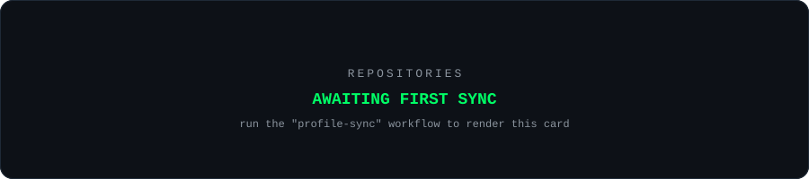


<table>
<tr>
<td width="50%" align="center" valign="top">
</td>
<td width="50%" align="center" valign="top">
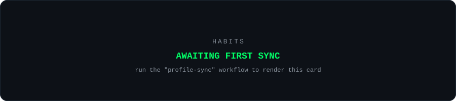
</td>
</tr>
<tr>
<td width="50%" align="center" valign="top">

</td>
<td width="50%" align="center" valign="top">
</td>
</tr>
</table>



  <a href="https://www.linkedin.com/in/antoniojtneto">LinkedIn</a> ·
  <a href="https://modrinth.com/user/ZpkDxGames">Modrinth</a> ·
  <a href="https://www.spigotmc.org/members/tonim.2373504/">SpigotMC</a> ·
  <a href="https://tonim-lp.vercel.app/">Creator hub</a>

For bug reports, include the server version, plugin version, reproduction steps, and the relevant stack trace.

  

